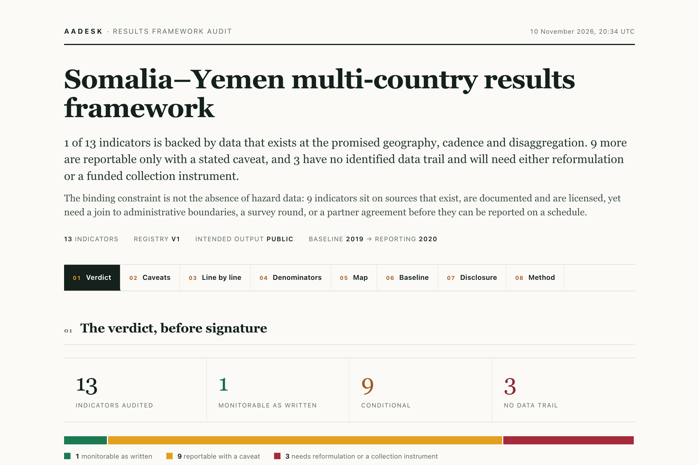
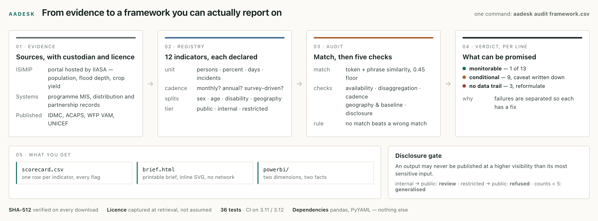
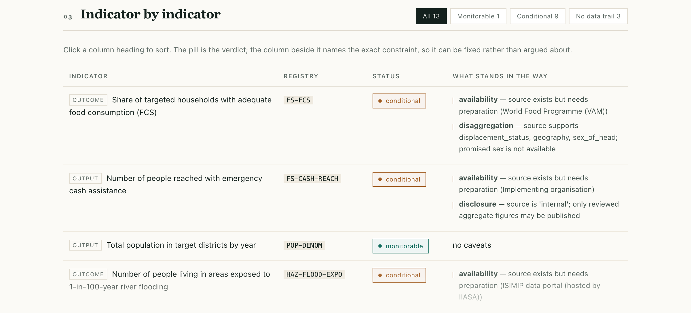
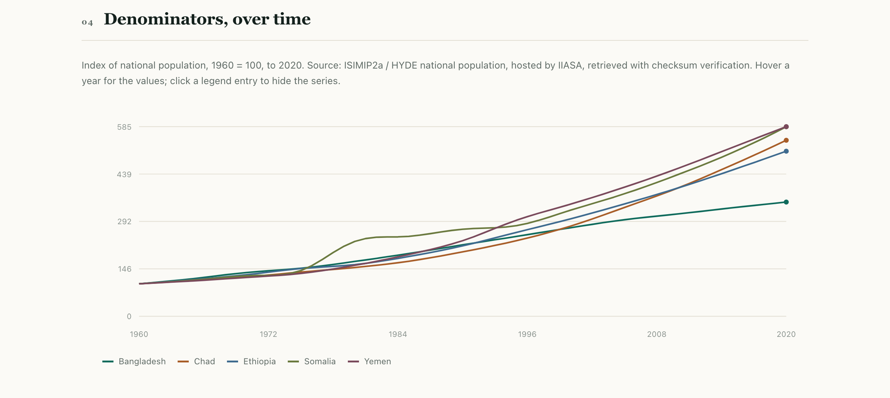
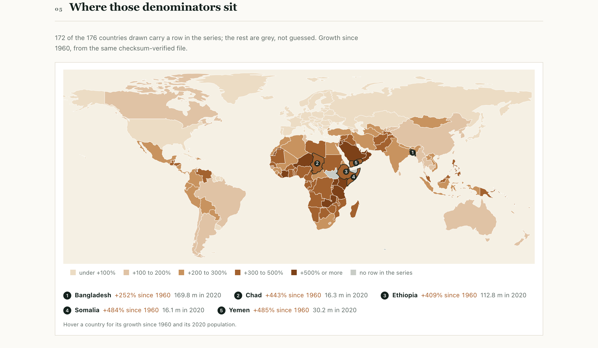

# aadesk

**An audit desk for humanitarian results frameworks: check whether an indicator can actually be measured — before the proposal is signed — then build the denominator from open, licensed, checksum-verified data.**

<p>
  
  
  
  
  
</p>

<p align="center">
  
</p>

<p align="center"><sub>The brief the tool actually emits for the example framework — a screenshot of <code>output/brief.html</code>, not a mock-up.</sub></p>

---

## Contents

1. [What this is](#what-this-is)
2. [The problem it is built around](#the-problem-it-is-built-around)
3. [How it works](#how-it-works)
4. [What the audit checks](#what-the-audit-checks)
5. [The brief](#the-brief)
6. [The IIASA / ISIMIP layer](#the-iiasa--isimip-layer)
7. [Why those five countries](#why-those-five-countries)
8. [What the example run found](#what-the-example-run-found)
9. [Design decisions worth defending](#design-decisions-worth-defending)
10. [Repository map](#repository-map)
11. [Running it](#running-it)
12. [The Power BI export](#the-power-bi-export)
13. [Publishing the brief](#publishing-the-brief)
14. [Licence and provenance](#licence-and-provenance)

---

## What this is

`aadesk` reads a results framework — the indicator table a humanitarian
programme is judged against — and answers three questions mechanically, before
the document is signed:

| | Question | Output |
|---|---|---|
| **1** | Does a documented source exist for this indicator, at the promised geography, cadence and disaggregation? | A verdict per line: monitorable, conditional, or no data trail |
| **2** | What is the denominator, and does the baseline year sit inside the series? | Numbers, with the growth and the drift since baseline |
| **3** | At what visibility may an output from this source be published? | A gate that tiers every output, and refuses record-level fields outright |

It ships with a curated registry of 12 indicators, a real client for the
ISIMIP data portal hosted by **IIASA**, 36 tests, and a brief that renders
offline.

**What it is not.** Not a dashboard product, not an LLM that writes proposals, and
not a judge of indicator *quality*. It tests whether data exists and can be
used; whether an indicator measures what its result statement claims is a
technical review that five availability checks cannot substitute for.

---

## The problem it is built around

A line like *"share of targeted households with adequate food consumption,
disaggregated by sex, reported quarterly"* reads as reasonable. It is also three
promises the source cannot keep: the food-consumption survey runs in rounds, not
quarters; the sample is not powered for sex-disaggregation at district level; and
the baseline year predates the current assessment series.

The cost is not abstract. It surfaces in month 18 — as a column of values carried
forward from the last survey round and reported to a donor as if it were
measurement, or as an indicator quietly dropped and never mentioned again.

The failure is almost always the same one: **availability was assumed rather than
checked.** That is a mechanical question, and it can be answered in a minute
instead of a year.

---

## How it works

<p align="center">
  
</p>

<p align="center"><sub>Evidence is declared before it is matched, and every output passes the disclosure gate on its way out — not afterwards.</sub></p>

The registry is the only place a claim about data is written down, and it is
**data, not prose**: each indicator carries its unit, cadence, promised
disaggregation, custodian and disclosure tier. That is what makes the audit
mechanical enough to run in CI against every new framework.

```console
$ aadesk audit data/examples/logframe_example.csv --outdir output
══════════════════════════════════════════════════════════════════════
AUDIT  Somalia–Yemen multi-country results framework
══════════════════════════════════════════════════════════════════════
  13 indicators · 1 monitorable · 9 conditional · 3 with no data trail
──────────────────────────────────────────────────────────────────────
  STATUS            REGISTRY            INDICATOR
  monitorable       POP-DENOM           Total population in target districts by year
  conditional       FS-FCS              Share of targeted households with adequate fo…
  conditional       HAZ-FLOOD-EXPO      Number of people living in areas exposed to 1…
  not monitorable   IM-DISABILITY       Number of beneficiaries with disability statu…
  unmatched         —                   Number of community feedback mechanisms estab…
──────────────────────────────────────────────────────────────────────
  disclosure gate
    FS-CASH-REACH   WARN   source is 'internal'; only reviewed aggregate figures may be published
```

A run writes four things: `scorecard.csv`, `assessments.json`, `brief.html`
(standalone, inline SVG, no network) and a Power BI star schema in
`output/powerbi/`.

---

## What the audit checks

| Check | Question | Failure it catches |
|---|---|---|
| **availability** | Is there a documented source with a named custodian? | "We will report on community feedback mechanisms" — no registry, no system, no data |
| **disaggregation** | Can the source produce the promised splits? | Sex-disaggregation promised from a national aggregate |
| **cadence** | Does collection rhythm support the reporting frequency? | Monthly GAM prevalence from an annual SMART survey |
| **geography / baseline** | Does the named country exist in the series, and is the baseline year inside its coverage? | Baseline 2015 against a series that stops in 2020 |
| **disclosure** | What is the highest visibility an output may carry? | Beneficiary counts from a programme MIS published as a public annex |

A fail makes the indicator **not monitorable**. A warning makes it **conditional** —
reportable, but only with the caveat written next to the number.

Matching is deliberately conservative: below a **0.45** score the line is reported as
`unmatched` rather than forced onto the nearest registry entry. A confident answer
about the wrong source is worse than an honest gap, and `Syrian Arab Republic` resolving
to `Serbia` is exactly the failure mode that threshold exists to prevent.

Full method, thresholds and known weaknesses: [`docs/methodology.md`](docs/methodology.md).

---

## The brief

One file, printable, self-contained: about seven A4 pages with the full table. It is
also interactive without a CDN, a build step or a tile server.

<p align="center">
  
</p>

<p align="center"><sub>One line per indicator. The pill is the verdict; the column beside it names the constraint, so it can be fixed rather than argued about.</sub></p>

- **Status chips** above the table filter the lines — `All 13`, `Monitorable 1`, `Conditional 9`, `No data trail 3`.
- **Click a column heading** to sort; severity sorts worst last, not alphabetically.
- **Hover a country** on the map for its growth and its 2020 population.
- **Hover a year** on the line chart for the values of every series at that year.
- **Click a legend entry** to hide that series.
- **The contents bar** marks the section you are reading and jumps to any other, so a seven-part
  document does not have to be scrolled blind.
- **The pipeline is in the page**, not only in this README: section 08 redraws the four stages
  and the three outputs in HTML, and survives printing as text.

The filters exist only on screen. `@media print` expands every row and drops the
chips, so the version that reaches a printer or a PDF is the complete one and
cannot disagree with the screen about a number.

---

## The IIASA / ISIMIP layer

The population denominators come from the **ISIMIP data portal hosted by IIASA**
(`population_histsoc_national_annual`, version `20210526`, HYDE methodology, **CC BY 4.0**).

`aadesk.iiasa` is a real client against the portal's REST API
(`https://data.isimip.org/api/v1/`, 1,001 public datasets). It resolves a dataset
by specifiers rather than by guesswork, downloads with **SHA-512 verification**
against the digest the portal publishes, refuses the file on mismatch, and
records retrieval time, dataset id, version, licence and specifiers in a
`.provenance.json` beside every download — so a later reader does not have to
trust a commit message.

```console
$ aadesk fetch --name population_histsoc_national_annual
DATASET  population_histsoc_national_annual
  version   20210526
  licence   CC BY 4.0 — Attribution 4.0 International
  ok  population_histsoc_national_annual_1901_2020.csv  (331 kB)  sha512 verified
```

The shipped extract covers **238 national units, 1901–2020, annual**, in thousands
of persons, converted to persons with the raw column kept so the unit conversion
stays auditable. Digest and retrieval record: [`data/reference/PROVENANCE.md`](data/reference/PROVENANCE.md).

<p align="center">
  
</p>

<p align="center"><sub>Indexing to 1960 puts a 170-million population and a 16-million one on the same axis. Somalia's late-1980s step is visible without a caption.</sub></p>

<p align="center">
  
</p>

<p align="center"><sub>The same series, drawn: 172 of the 176 countries the geometry covers carry a row. The four grey ones are grey because the series has no row for them — not because they are small or inconvenient.</sub></p>

**What is catalogued but not yet computed.** The registry also references the ISIMIP
CaMa-Flood 100-year flood-depth layer and the gridded crop-model output. Both are
open and verified in the catalogue; neither is yet a national indicator here,
because that needs an administrative boundary raster, per-cell population weighting
and an explicit exposure threshold. They are recorded as `partial` and audited as
**conditional**, rather than presented as numbers the pipeline has not earned.
That join is the obvious next piece of work — see [`docs/limitations.md`](docs/limitations.md).

---

## Why those five countries

The five countries in the charts are not a selection — they are the `geography`
column of [`data/examples/logframe_example.csv`](data/examples/logframe_example.csv),
and the brief plots whatever the framework names. The example was written so that
each one exercises a different failure the audit is meant to catch:

| Country | Why it is in the example |
|---|---|
| **Somalia** | The multi-indicator caseload: cash, localisation, access constraints, trigger latency. Carries the `no data trail` cases, and a series step in the late 1980s that a baseline-year argument has to survive. |
| **Yemen** | Displacement and access — a promising `quarterly` cadence against an annual, lagged publication, where stock and flow are also being conflated. |
| **Bangladesh** | The flood-exposure indicator: largest denominator in the set, and the case where a gridded hazard layer exists but no boundary join has been done. |
| **Ethiopia** | A `seasonal` crop-yield anomaly, to test whether cadence ranks handle seasonality honestly. |
| **Chad** | A second cash programme with a different custodian and disclosure tier, so the gate is exercised twice on the same indicator type. |

They also happen to span `+252%` (Bangladesh) to `+485%` (Yemen) growth since
1960, which is what makes the denominator argument visible rather than theoretical.

---

## What the example run found

The framework in `data/examples/logframe_example.csv` is **synthetic** — written
to exercise every failure mode, not to describe a real proposal. Across 13 lines:

- **1** is backed by data available as-is (the population denominator).
- **9** are conditional, and the binding constraint is not missing hazard data but
  *state of preparation*: sources that exist and are licensed still need a boundary
  join, a survey round, or a partner agreement.
- **3** have no data trail. Two are real indicators with no monitorable source
  (disability status, women in partner decision-making); one — community feedback
  mechanisms — has no registry equivalent at all.

Two findings a proposal team can act on before signature:

- a **monthly** malnutrition prevalence indicator against an annual survey — the
  values would be carried forward, not measured;
- a **quarterly** displacement indicator against annual IDMC publication with a
  publication lag, where stock and flow are also being conflated.

---

## Design decisions worth defending

- **Unmatched over best-guess.** A forced match produces a confident answer about
  the wrong source. The 0.45 floor and the `unmatched` status exist so the tool
  can say *I don't know*.
- **Checksums, not trust.** A digest recorded at download time is the difference
  between "we used the 2021 series" and "we believe we used the 2021 series".
- **No silent filtering.** `disclosure.enforce()` returns what it dropped. A filter
  that quietly removes a field is how that field reappears two reports later.
- **Offline by default.** `extract` is rule-based; the LLM path is documented but
  off, because proposal text often contains protection-sensitive detail and sending
  it to a third-party API is a data-protection decision, not a convenience.
  [`docs/extraction.md`](docs/extraction.md)
- **No map library.** The choropleth is inline SVG over 176 simplified boundary
  rings shipped in the repo: a brief that needs `tiles.openstreetmap.org` is not a
  brief. Boundaries are cartographic, not an authoritative depiction —
  [`docs/limitations.md`](docs/limitations.md).

---

## Repository map

```
aadesk/
├── config/
│   ├── registry/indicators.yml     curated registry: definition, source, cadence, disclosure
│   └── sources.yml                 custodians, access conditions, licences
├── data/
│   ├── reference/                  ISIMIP population extract + SHA-512 provenance,
│   │                               Natural Earth 110m boundaries for the map
│   ├── examples/                   synthetic framework used by the demo
│   └── cache/                      downloads (gitignored)
├── src/aadesk/
│   ├── iiasa.py                    ISIMIP portal client: resolve, verify, record provenance
│   ├── denominators.py             units, aliases, coverage, baseline drift
│   ├── registry.py                 schema + validation
│   ├── rfcheck.py                  matching and the five checks
│   ├── disclosure.py               tiering, small-count suppression
│   ├── report.py                   standalone HTML brief, Power BI star schema
│   ├── mapview.py                  inline-SVG world choropleth, no tiles, no JS library
│   ├── extract.py                  rule-based indicator extraction from proposal text
│   └── cli.py
├── docs/                           methodology · data protection · extraction · limitations
├── assets/                         figures in this README (sources in assets/src/)
├── tests/                          36 tests, including regression cases
└── output/                         example run: scorecard, brief, Power BI model
```

---

## Running it

```bash
python -m venv .venv && source .venv/bin/activate
pip install -e ".[dev]"

aadesk validate
aadesk audit data/examples/logframe_example.csv --outdir output
aadesk denominators --country Somalia --country Yemen --year 2020 --drift --baseline 2015
aadesk fetch          # live download from the ISIMIP portal, checksum verified
aadesk extract proposal.txt
pytest
```

Dependencies are `pandas` and `PyYAML` only. The brief renders with no plotting
library and no external assets. `make test`, `make audit` and `make pages` do the
same steps through `make`.

---

## The Power BI export

`output/powerbi/` holds four CSVs — two dimensions, two fact tables — plus
`measures.dax` and `model.md`. It is a **model, not a `.pbix`**: a workbook with
someone's slicer layout in it is a binary nobody can review or merge. The
interactivity comes from Power BI itself on import, which takes about two minutes:

1. **Get data → Text/CSV**, one file at a time. On the import dialog set *File origin*
   to `65001: Unicode (UTF-8)` — a wrong origin turns `Côte d'Ivoire` into noise.
2. **Model view**: drag `dim_indicator[indicator_id]` onto `fact_assessment[matched_id]`,
   and `dim_country[country]` onto `fact_denominator[country]`. Many-to-one, single direction.
3. **Paste the measures** from `measures.dax` — indicators audited, monitorable count,
   monitorable share, latest population, growth since 1960.
4. A defensible first screen: a status slicer, a *Monitorable share* card, a status × geography
   matrix, and population by year as a line.

Field list and the reason for each relationship: [`output/powerbi/model.md`](output/powerbi/model.md).

---

## Publishing the brief

`docs/index.html` is a copy of the brief, so GitHub Pages serves it with no build.

The repository is public, so the brief can be read without cloning:

**https://caoqyqianyi.github.io/aa-data-desk/**

That URL is `docs/index.html` served by Pages, branch `main`, folder `/docs` —
the same file as `output/brief.html`, copied by `make pages`.

---

## Licence and provenance

Code: **MIT**. Data: the shipped extract is the ISIMIP/HYDE national population
series served by the ISIMIP portal hosted by IIASA, **CC BY 4.0** — attribution
required, and dataset rights should be re-checked at the portal before reuse.
Boundary geometry is Natural Earth 110m, public domain.

See [`LICENSE`](LICENSE), [`NOTICE.md`](NOTICE.md) and
[`data/reference/PROVENANCE.md`](data/reference/PROVENANCE.md).

---

<sub>Built by <a href="https://github.com/caoqyqianyi">Qianyi Cao</a> — data scientist working on
geospatial and climate data for humanitarian and development contexts.</sub>
